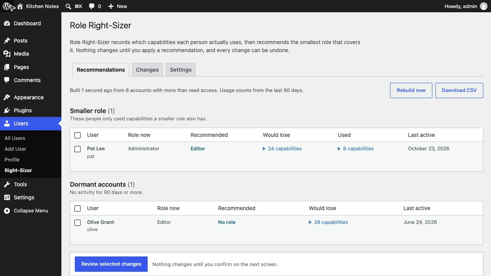
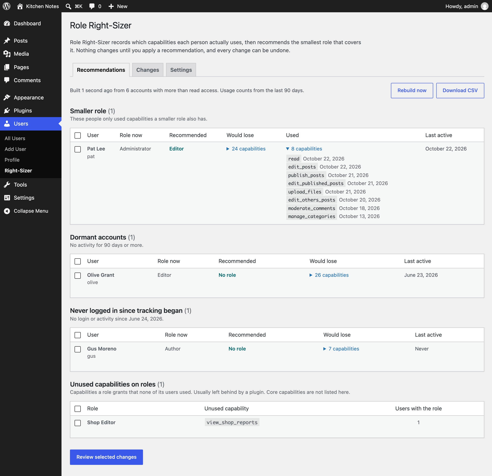
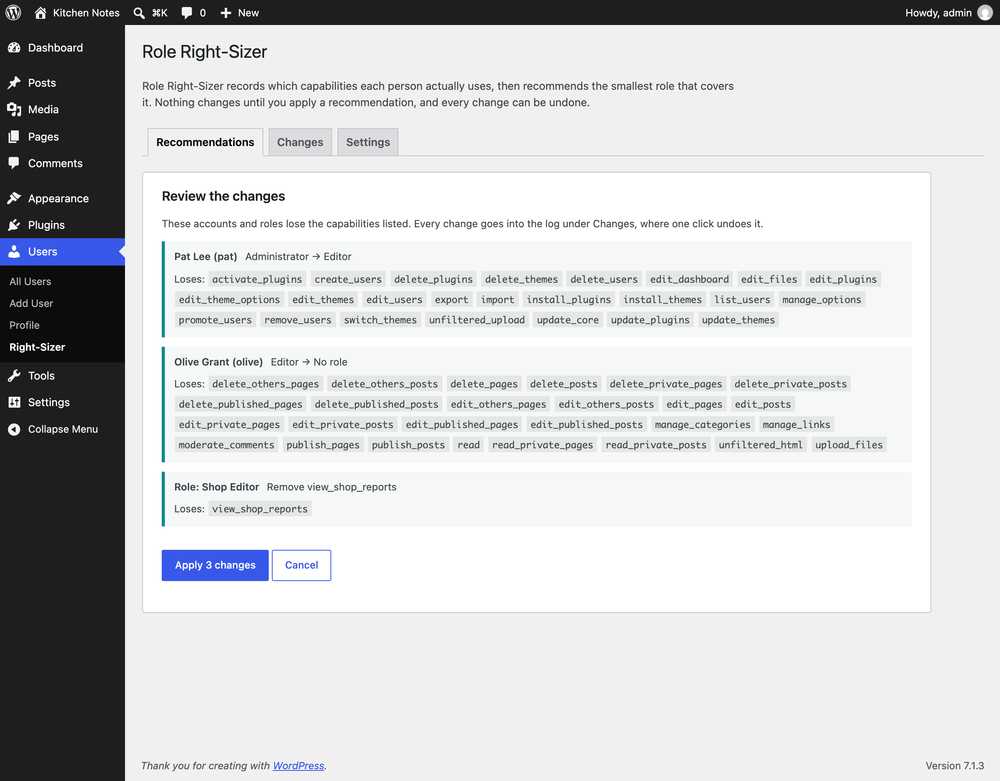
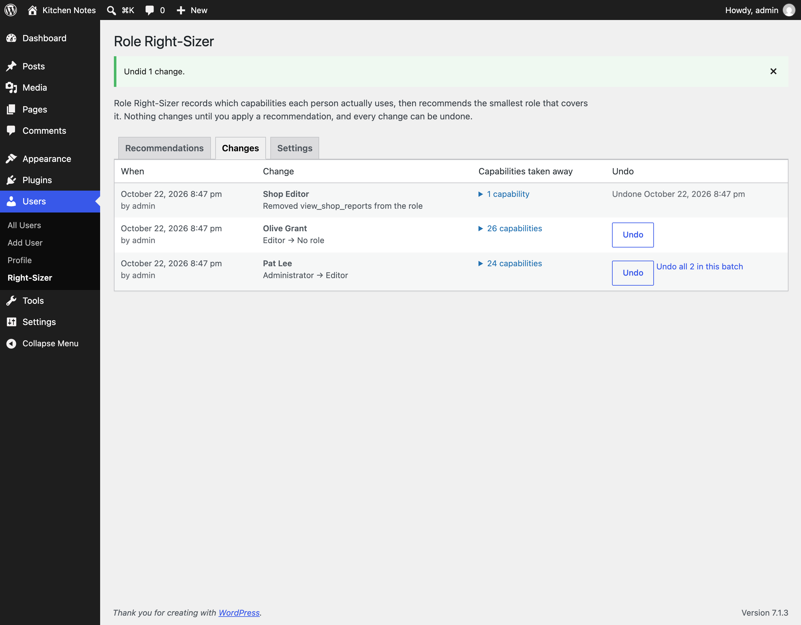
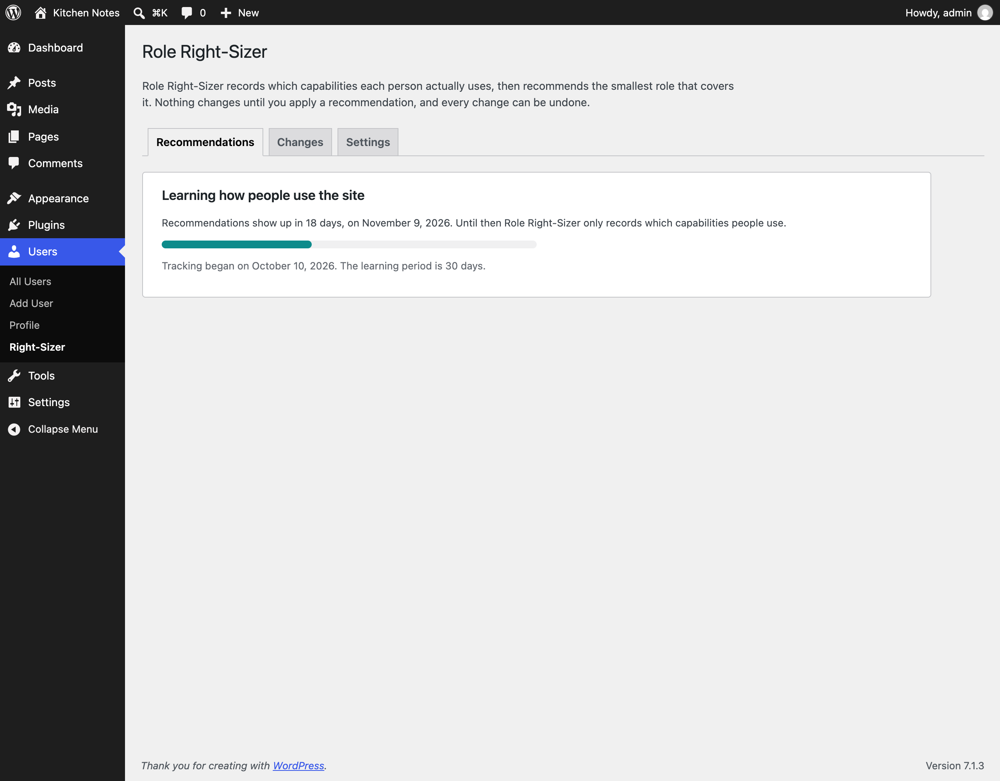

<p align="center"></p>

<h1 align="center">Role Right-Sizer</h1>

<p align="center">
  <a href="https://playground.wordpress.net/?blueprint-url=https://raw.githubusercontent.com/aryanjasala/role-right-sizer/main/blueprint.json"></a>
  <a href="https://github.com/aryanjasala/role-right-sizer/releases/latest"></a>
  
  
  <a href="LICENSE.md"></a>
  <br>
  <a href="https://github.com/aryanjasala/role-right-sizer/actions/workflows/phpcs.yml"></a>
  <a href="https://github.com/aryanjasala/role-right-sizer/actions/workflows/phpstan.yml"></a>
  <a href="https://github.com/aryanjasala/role-right-sizer/actions/workflows/unit-tests.yml"></a>
  <a href="https://github.com/aryanjasala/role-right-sizer/actions/workflows/e2e-tests.yml"></a>
  <a href="https://github.com/aryanjasala/role-right-sizer/actions/workflows/plugin-check.yml"></a>
</p>

<p align="center">Recommends the smallest role each user needs, based on what they actually do. Spots dormant accounts and unused capabilities, and every change undoes in one click.</p>

<p align="center">
  
</p>

---

Sites collect administrators who only ever write posts, old agency accounts nobody uses, and capabilities a plugin added years ago. Role editors let you change roles, but they don't tell you what to change. Role Right-Sizer records which capabilities each person actually uses, then recommends the smallest role that covers it. Nothing changes until you apply a recommendation, and every change can be undone.

> [!NOTE]
> Free and open source under the GPL. No pro version, no upsells, no ads in wp-admin, no tracking. And it stays that way.

## Features

- **Usage recording** from the events WordPress already fires, admin screen visits, REST requests that change something, and ability runs. Written once per request, at most once an hour per capability
- **Smaller role**: the smallest existing role that covers everything a person used, with the capabilities they would lose and when they last used each one
- **Dormant accounts** (no activity for 90 days) and **never logged in since tracking began**, with no role or a fallback role
- **Unused capabilities on roles**: plugin and custom capabilities no user of the role used
- **Confirmation** that lists every capability a change takes away, and a **change log** with Undo for one change or a whole batch
- **Safe by default**: a 30-day learning period, never more access than now, the last administrator and your own account are never changed, exclude lists for people and roles
- **CSV download**, **WP-CLI**, **abilities** for AI agents, a **Site Health** check, and filters and actions for every default and change

## Install

1. Download `role-right-sizer.zip` from the [latest release](https://github.com/aryanjasala/role-right-sizer/releases/latest).
2. In WordPress, go to **Plugins > Add New Plugin > Upload Plugin**, choose the zip and activate it.

Or with WP-CLI:

```sh
wp plugin install https://github.com/aryanjasala/role-right-sizer/releases/latest/download/role-right-sizer.zip --activate
```

Needs WordPress 6.6+ and PHP 7.4+. To try it first, the **Try in WordPress Playground** badge opens a throwaway WordPress in your browser with the plugin and some demo content.

## Quick look

After the learning period, see and apply recommendations from the command line, with a dry run first:

```sh
wp role-right-sizer report
wp role-right-sizer apply --all --dry-run
wp role-right-sizer apply pat
wp role-right-sizer undo 12 --batch
```

Recommendations change roles through core's own `set_role()`, so other plugins see every change.

## Screenshots

<table>
  <tr>
    <td width="50%" valign="top"> Right-Sizer: a smaller role, dormant accounts and unused capabilities on roles"><br><sub>Users > Right-Sizer: a smaller role, dormant accounts and unused capabilities on roles</sub></td>
    <td width="50%" valign="top"><br><sub>The confirmation step lists every capability each change takes away</sub></td>
  </tr>
  <tr>
    <td width="50%" valign="top"><br><sub>The change log, with Undo for one change or the whole batch</sub></td>
    <td width="50%" valign="top"><br><sub>The learning period, with how long is left before recommendations show up</sub></td>
  </tr>
</table>

## Documentation

| Doc | What it covers |
| --- | --- |
| [Reference](docs/REFERENCE.md) | How usage is recorded, how recommendations are made, hooks, abilities, WP-CLI and what is stored |
| [Development](docs/DEVELOPMENT.md) | Local setup, commands and tests |
| [Contributing](docs/CONTRIBUTING.md) | Pull requests, required checks and PR titles |
| [Releasing](docs/RELEASING.md) | How merged pull requests become releases |
| [Security](docs/SECURITY.md) | Reporting a vulnerability |
| [readme.txt](readme.txt) | What WordPress.org shows, with the FAQ and changelog |

## Project structure

```
role-right-sizer.php        plugin header and PSR-4 autoloader
src/
├── Plugin.php              creates the services
├── Settings.php            settings, tracking start and the filtered limits
├── Usage/
│   ├── Recorder.php        collects use in a request, writes it on shutdown
│   ├── HookMap.php         which hook proves which capability
│   ├── AdminScreens.php    admin screen visits
│   ├── RestWatcher.php     REST permission checks and ability runs
│   └── Store.php           per-user, per-site storage
├── Recommender.php         smallest role, dormant, never logged in, unused capabilities
├── Report.php              batched build, kept in an option
├── Applier.php             apply and undo, with the protections
├── Changes.php             the change log
├── Admin/                  Users > Right-Sizer and the network screen
├── Health/SiteHealth.php   the Site Health check
├── Privacy.php             exporter, eraser, policy text
├── Abilities.php           abilities for AI agents
└── Cli/Command.php         wp role-right-sizer
assets/admin.css
tests/
├── Unit/                   PHPUnit
└── e2e/                    Playwright specs and the Docker site
.wordpress-org/             screenshots, icon and banner
docs/                       reference, development, contributing, releasing
```

## More free plugins

Small plugins that each fill one gap in WordPress, all free with no pro version:

| | Plugin | What it does |
| --- | --- | --- |
|  | [Page Template Usage](https://github.com/aryanjasala/page-template-usage) | See which template every page uses, and fix the pages on a missing template |
|  | [Staging Guard](https://github.com/aryanjasala/staging-guard) | Stops staging copies from emailing real people or getting indexed |
|  | [Category & Tag Trash](https://github.com/aryanjasala/category-tag-trash) | A trash for categories, tags and custom terms, with undo and full restore |
|  | [Site Read-Only Mode](https://github.com/aryanjasala/site-read-only-mode) | Read-only mode for WordPress during migrations and deploys |
|  | [Restore Blocks from Revisions](https://github.com/aryanjasala/restore-blocks-from-revisions) | Restore a single block from an old revision, not the whole post |

## License

[GPL-2.0-or-later](LICENSE.md) © Aryan Jasala
