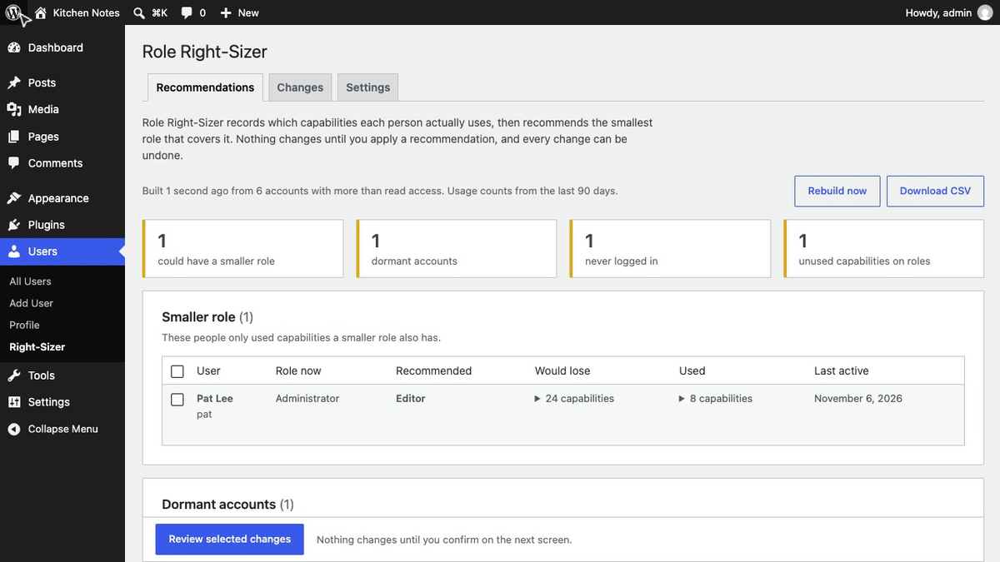
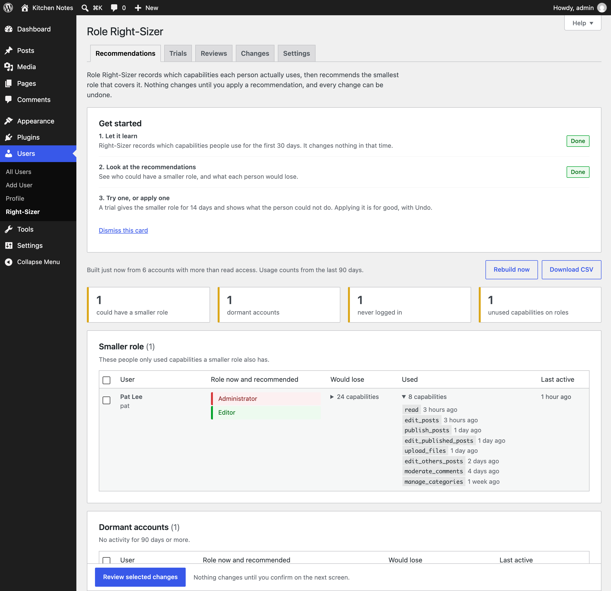
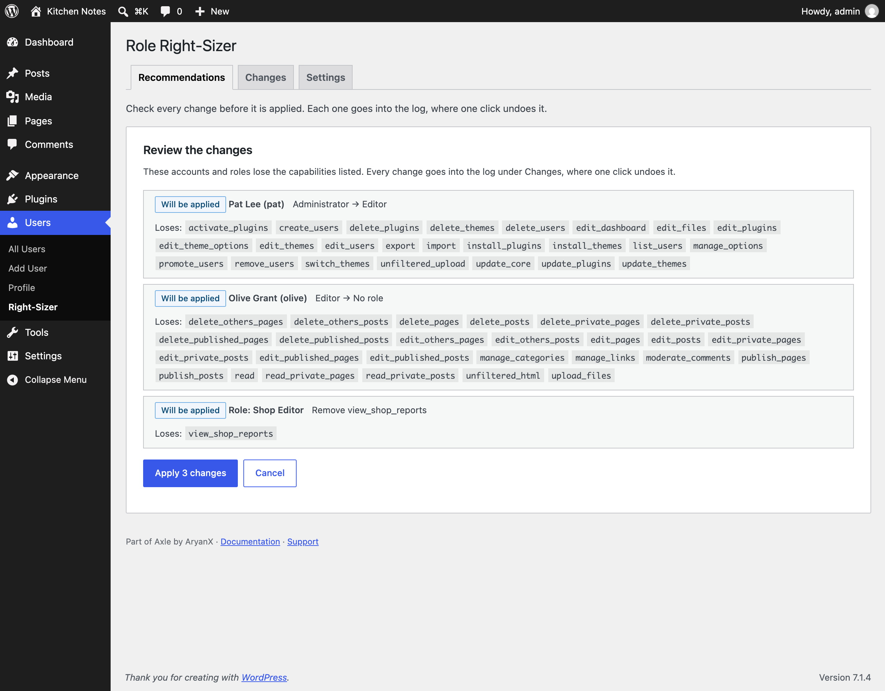
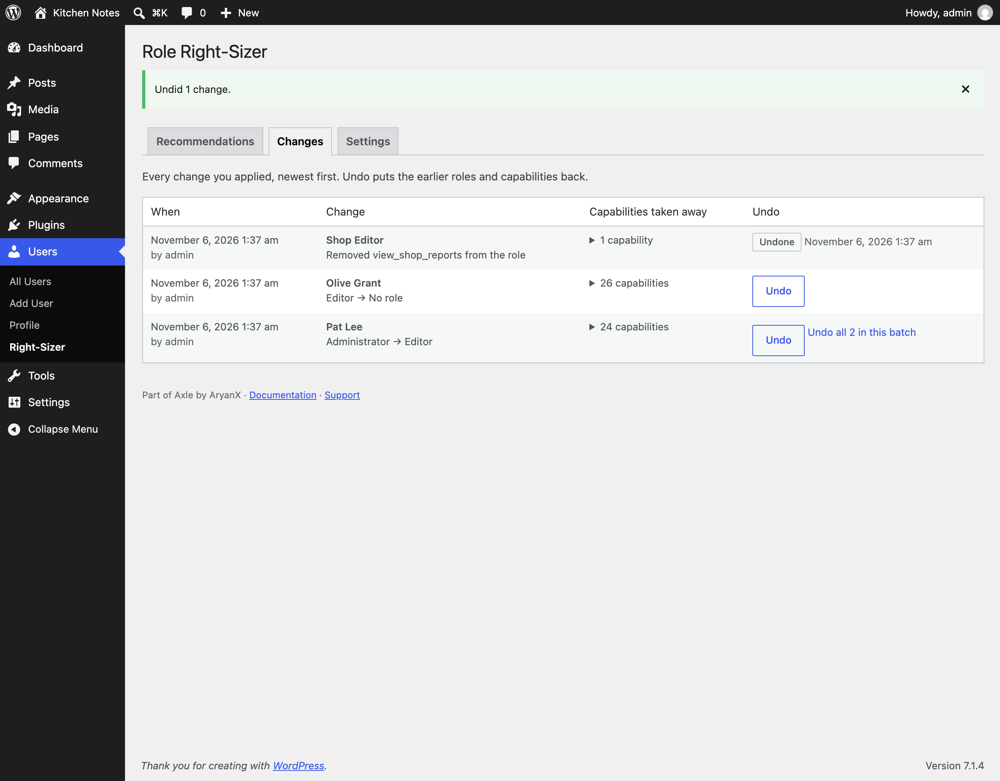
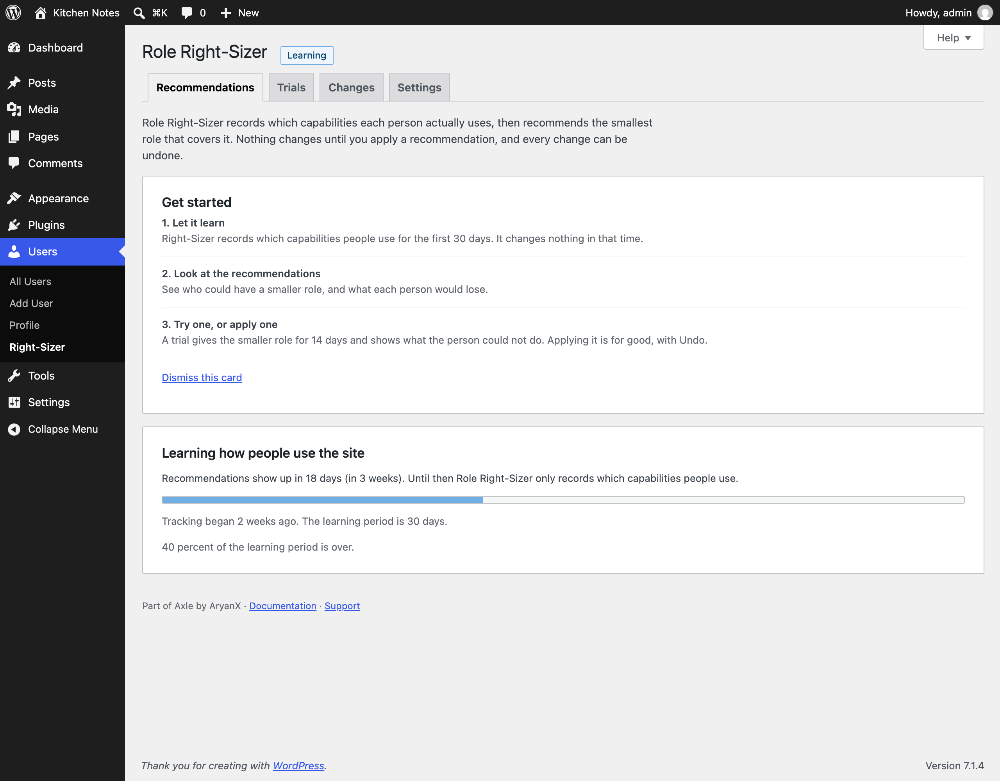

<p align="center"></p>

<h1 align="center">Role Right-Sizer</h1>

<p align="center">
  <a href="https://try.axlewp.com/role-right-sizer"></a>
  <a href="https://github.com/aryanjasala/role-right-sizer/releases/latest"></a>
  
  
  <a href="LICENSE.md"></a>
  <br>
  <a href="https://github.com/aryanjasala/role-right-sizer/actions/workflows/phpcs.yml"></a>
  <a href="https://github.com/aryanjasala/role-right-sizer/actions/workflows/phpstan.yml"></a>
  <a href="https://github.com/aryanjasala/role-right-sizer/actions/workflows/unit-tests.yml"></a>
  <a href="https://github.com/aryanjasala/role-right-sizer/actions/workflows/e2e-tests.yml"></a>
  <a href="https://github.com/aryanjasala/role-right-sizer/actions/workflows/plugin-check.yml"></a>
</p>

<p align="center">Recommends the smallest role each user needs, based on what they actually do. Spots dormant accounts and unused capabilities, and every change undoes in one click.</p>

<p align="center">
  
</p>

---

Sites collect administrators who only ever write posts, old agency accounts nobody uses, and capabilities a plugin added years ago. Role editors let you change roles, but they don't tell you what to change. Role Right-Sizer records which capabilities each person actually uses, then recommends the smallest role that covers it. Nothing changes until you apply a recommendation, and every change can be undone. If you are not sure, try the smaller role for 14 days first: Right-Sizer records what the person could not do, and one click gives the old role back.

> [!NOTE]
> Free and open source under the GPL. No pro version, no upsells, no ads in wp-admin, no tracking. And it stays that way.

## Features

- **Usage recording** from the events WordPress already fires, admin screen visits, REST requests that change something, and ability runs. Written once per request, at most once an hour per capability
- **Smaller role**: the smallest existing role that covers everything a person used, with the capabilities they would lose and when they last used each one
- **Dormant accounts** (no activity for 90 days) and **never logged in since tracking began**, with no role or a fallback role
- **Unused capabilities on roles**: plugin and custom capabilities no user of the role used, grouped by role and by the plugin they belong to. Never on the Administrator role, and only once a capability has been on its role for the whole window
- **Trials**: give someone the smaller role for 14 days. Right-Sizer records every wall they hit, such as a screen they could not open or a page by another author they could not edit, grouped and counted. They see a message with a button to ask for their access back. Restore, extend or make permanent from the Trials tab
- **Confirmation** that lists every capability a change takes away, and a **change log** with Undo for one change or a whole batch
- **Safe by default**: a 30-day learning period, never more access than now, the last administrator and your own account are never changed, administrator capabilities are never suggested for removal, an active plugin's capabilities are marked and left out of `apply --all`, exclude lists for people and roles
- **CSV download**, **WP-CLI**, **abilities** for AI agents, a **Site Health** check, and filters and actions for every default and change. Someone who may open the screen but not edit an account never sees that account's capabilities

## Install

1. Download `role-right-sizer.zip` from the [latest release](https://github.com/aryanjasala/role-right-sizer/releases/latest).
2. In WordPress, go to **Plugins > Add New Plugin > Upload Plugin**, choose the zip and activate it.

Or with WP-CLI:

```sh
wp plugin install https://github.com/aryanjasala/role-right-sizer/releases/latest/download/role-right-sizer.zip --activate
```

Needs WordPress 6.6+ and PHP 7.4+. To try it first, [try.axlewp.com/role-right-sizer](https://try.axlewp.com/role-right-sizer) opens a private WordPress in your browser with the latest release and some demo content. Nothing to install.

## Quick look

After the learning period, see and apply recommendations from the command line, with a dry run first:

```sh
wp role-right-sizer report
wp role-right-sizer apply --all --dry-run
wp role-right-sizer apply pat
wp role-right-sizer undo 12 --batch
```

Try the smaller role for two weeks first, and see what the person could not do:

```sh
wp role-right-sizer trial start pat
wp role-right-sizer trial list --status=open
wp role-right-sizer trial denials 3
wp role-right-sizer trial keep 3
```

Recommendations change roles through core's own `set_role()`, so other plugins see every change.

## Screenshots

<table>
  <tr>
    <td width="50%" valign="top"> Right-Sizer: a smaller role, dormant accounts and unused capabilities on roles, grouped by role"><br><sub>Users > Right-Sizer: a smaller role, dormant accounts and unused capabilities on roles, grouped by role</sub></td>
    <td width="50%" valign="top"><br><sub>The confirmation step lists every capability each change takes away</sub></td>
  </tr>
  <tr>
    <td width="50%" valign="top"><br><sub>The change log, with Undo for one change or the whole batch</sub></td>
    <td width="50%" valign="top"><br><sub>The learning period, with how long is left before recommendations show up</sub></td>
  </tr>
</table>

## Documentation

| Doc | What it covers |
| --- | --- |
| [Reference](docs/REFERENCE.md) | How usage is recorded, how recommendations are made, trials, hooks, abilities, WP-CLI and what is stored |
| [Development](docs/DEVELOPMENT.md) | Local setup, commands and tests |
| [Contributing](docs/CONTRIBUTING.md) | Pull requests, required checks and PR titles |
| [Releasing](docs/RELEASING.md) | How merged pull requests become releases |
| [Security](docs/SECURITY.md) | Reporting a vulnerability |
| [readme.txt](readme.txt) | What WordPress.org shows, with the FAQ and changelog |

## Project structure

```
role-right-sizer.php        plugin header and PSR-4 autoloader
src/
├── Plugin.php              creates the services
├── Settings.php            settings, tracking start and the filtered limits
├── Usage/
│   ├── Recorder.php        collects use in a request, writes it on shutdown
│   ├── HookMap.php         which hook proves which capability
│   ├── AdminScreens.php    admin screen visits
│   ├── RestWatcher.php     REST permission checks and ability runs
│   └── Store.php           per-user, per-site storage
├── Recommender.php         smallest role, dormant, never logged in, unused capabilities
├── Report.php              batched build, kept in an option
├── Applier.php             apply and undo, with the protections
├── Changes.php             the change log
├── Trials.php              trials: start, restore, extend, keep, denials, emails
├── Access.php              who may see which account
├── Trial/Watcher.php       records what a person on trial could not do
├── Admin/                  Users > Right-Sizer and the network screen
├── Health/SiteHealth.php   the Site Health check
├── Privacy.php             exporter, eraser, policy text
├── Abilities.php           abilities for AI agents
└── Cli/                    wp role-right-sizer and wp role-right-sizer trial
assets/admin.css
tests/
├── Unit/                   PHPUnit
└── e2e/                    Playwright specs and the Docker site
.wordpress-org/             screenshots, icon and banner
docs/                       reference, development, contributing, releasing
```

## More free plugins

Small plugins that each fill one gap in WordPress, all free with no pro version. Try them all together at [demo.axlewp.com](https://demo.axlewp.com/).

| | Plugin | What it does |
| --- | --- | --- |
|  | [Axle Page Template Usage](https://github.com/aryanjasala/axle-page-template-usage) | See which template every page uses, and fix the pages on a missing template |
|  | [Axle Staging Guard](https://github.com/aryanjasala/axle-staging-guard) | Stops staging copies from emailing real people, calling live APIs or getting indexed |
|  | [Axle Category & Tag Trash](https://github.com/aryanjasala/axle-category-tag-trash) | A trash for categories, tags and custom terms, with undo and full restore |
|  | [Axle Read-Only Mode](https://github.com/aryanjasala/axle-read-only-mode) | Read-only mode for WordPress during migrations and deploys |
|  | [Axle Block Restore](https://github.com/aryanjasala/axle-block-restore) | Restore a single block from an old revision, not the whole post |
|  | [Activity Log with Undo](https://github.com/aryanjasala/activity-log-with-undo) | An activity log where every change you can reverse has an Undo button |
|  | [Agent Governance](https://github.com/aryanjasala/agent-governance) | Hold risky AI agent calls for approval, preview what they change, and roll back a session |
|  | [Axle AI Guard](https://github.com/aryanjasala/axle-ai-guard) | See and control every AI call your plugins make: cost, data sent, budgets and a kill switch |
|  | [Axle Config Sync](https://github.com/aryanjasala/axle-config-sync) | Keep settings in git, diff them against the live site, apply with a preview and undo |
|  | [Axle Leftovers](https://github.com/aryanjasala/axle-leftovers) | Find what deleted plugins left behind, see who owns it and why, and clean it up with undo |
|  | [Axle License Tracker](https://github.com/aryanjasala/axle-license-tracker) | See which premium plugins are licensed, which lapsed and stopped getting updates, and what renews when |
|  | [Axle Review](https://github.com/aryanjasala/axle-review) | Share drafts through private links and collect outside feedback as block Notes |
|  | [Axle Runtime Doctor](https://github.com/aryanjasala/axle-runtime-doctor) | Check OPcache coverage, the object cache, PHP support and limits, cron and more, with the fix for your host |
|  | [Axle Smoke Test](https://github.com/aryanjasala/axle-smoke-test) | Check key pages after every update or deploy, see what broke and roll it back |
|  | [Block Doctor](https://github.com/aryanjasala/block-doctor) | Scan the whole site for invalid and broken blocks and fix them in bulk, with undo |
|  | [Block Theme Ops](https://github.com/aryanjasala/block-theme-ops) | Find Site Editor changes that override your theme files, see the diff, reset them or send them to Git |
|  | [Update Rehearsal](https://github.com/aryanjasala/update-rehearsal) | Try plugin, theme, core and PHP updates on a disposable copy of your site in WordPress Playground first |
|  | [User Session Manager](https://github.com/aryanjasala/user-session-manager) | See every device signed in, sign out one, and limit sessions per role |

## License

Copyright Aryan Jasala. Licensed under [GPL-2.0-or-later](LICENSE.md).
